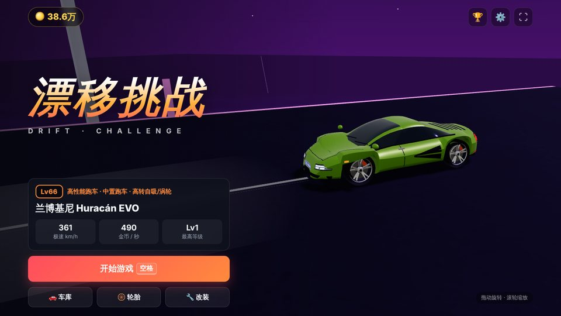
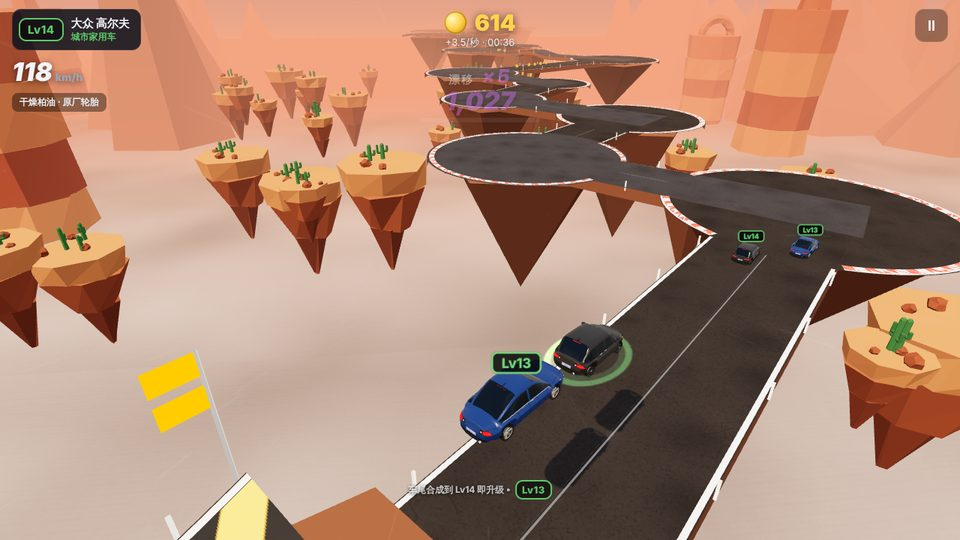
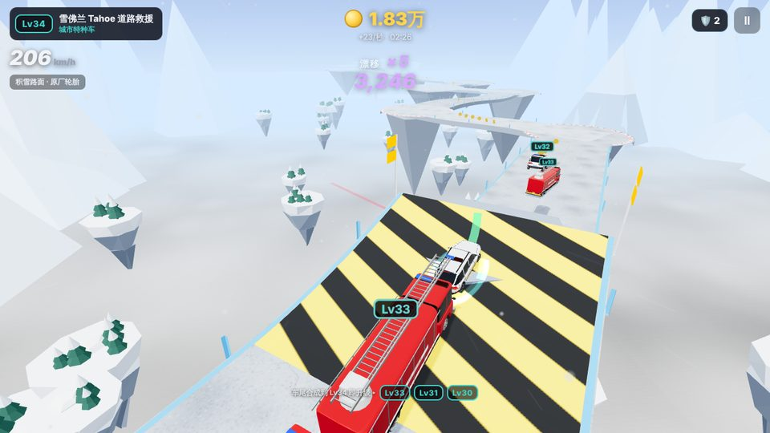
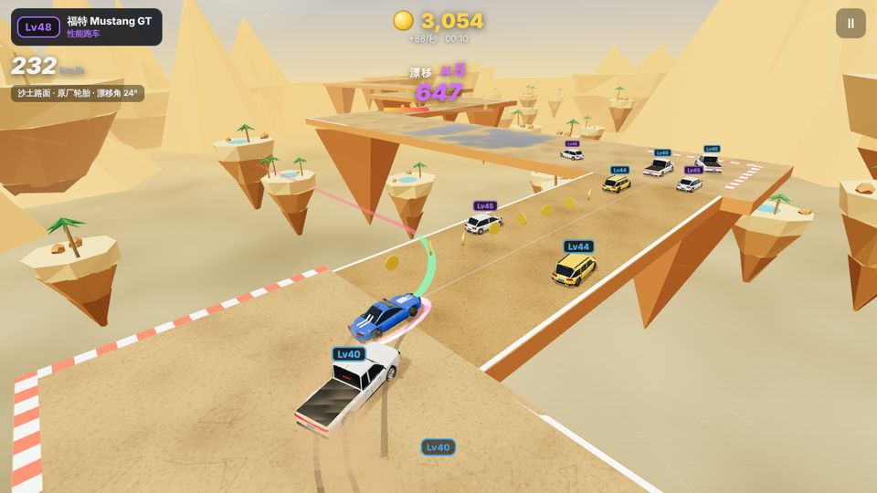
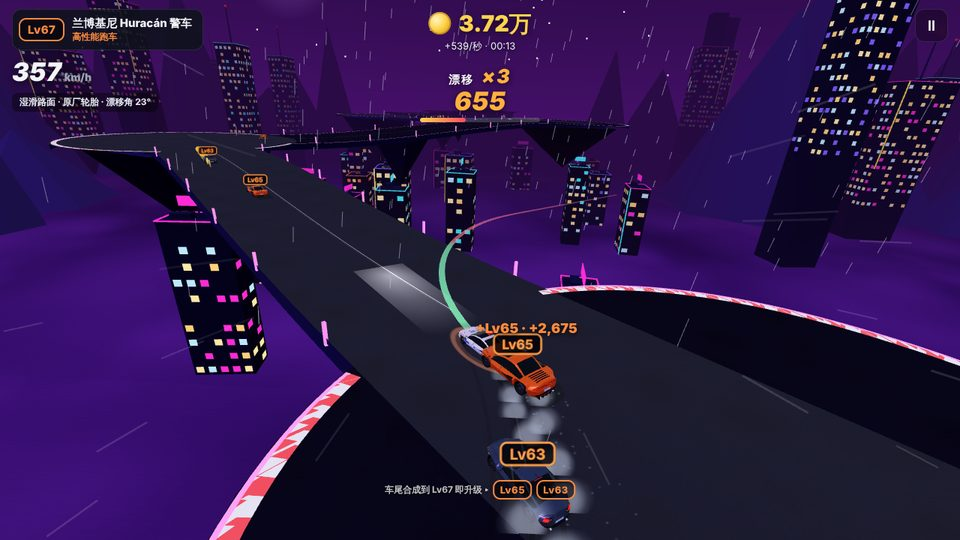
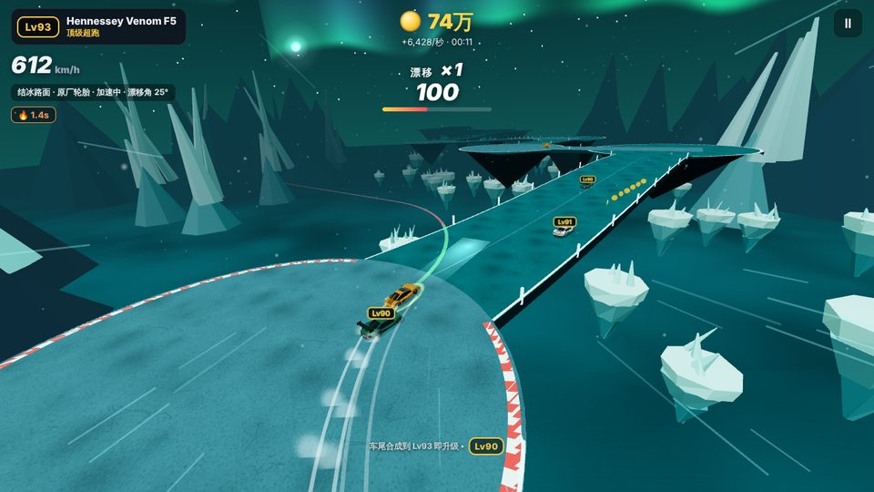
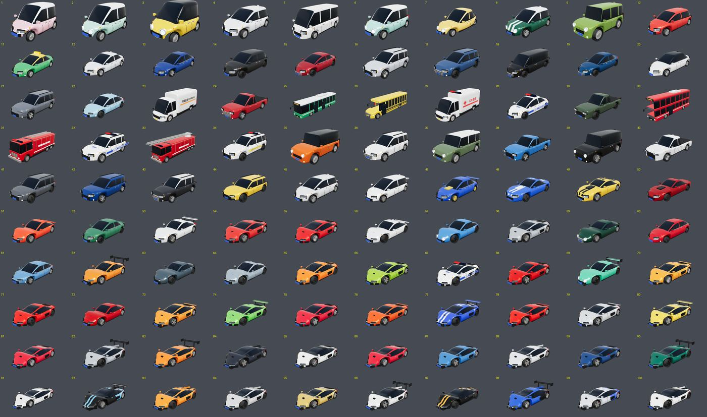

# Drift-Challenge 漂移挑战

一款基于网页 3D（Three.js）的赛车漂移小游戏。纯前端静态页面，**直接用浏览器打开 `index.html` 即可游玩**，无需安装或启动服务器（Three.js 已内置在 `js/lib/`，离线也能玩）。

## 截图

| | |
|---|---|
|  |  |
|  |  |
|  |  |

100 辆车一览：



## 在线游玩（可选）

游戏是纯静态页面，可以用 GitHub Pages 直接托管：在仓库的 Settings → Pages 里，Source 选 “Deploy from a branch”，分支选 `main`、目录选 `/ (root)`，保存后等一两分钟，就能通过 `https://<用户名>.github.io/Drift-Challenge/` 在电脑和手机上打开。

## 玩法

- **操作**：按住 `空格`（手机上按住屏幕）往左行驶，松开往右行驶。车头不会转过目标方向（下一段路的方向）。
- **漂移物理**（`js/physics.js`）：
  - 车的速度是一个向量，只会被轮胎摩擦力、发动机推力和重力改变，转向时动量还在，车会侧滑一段，速度不会突然归零。
  - 轮胎摩擦力按接地点的滑移速度计算，最大不超过 μ × 法向载荷（重力 + 下压力）。滑移小时抓地，超过峰值后变为滑动摩擦，系数下降，于是持续侧滑，直到侧滑减小才重新抓地。
  - 漂移时后轮空转，摩擦力偏向车头方向，推着车绕弯，所以过弯一般只损失 10%~20% 车速；发动机越弱掉速越多。
  - 车头转动受转动惯量限制，长车（公交、消防车）转得慢；前轮会反打方向指向行进方向。
  - 路面（柏油、积雪、沙土、湿滑、结冰）、车型和轮胎决定摩擦系数，越滑侧滑越远。上坡减速、下坡加速，空中保持惯性。
  - 每辆车的下压力按路宽校准：原厂轮胎过 90° 弯时侧滑距离约为路宽的 0.88 倍，所以车越快侧滑越长，各等级的漂移时间接近。弯越急滑得越远。
- **漂移蓄力**：侧滑时积累蓄力，后轮火花依次变成蓝、橙、紫三档；连续过弯会一直叠加，直道上逐渐消退。每次回正抓地的瞬间按当前档位喷射加速（短时间提高极速和加速度，并奖励金币）。
- **漂移效果**：成团停留的轮胎烟、随时间淡去的连续胎痕；雪地扬雪、沙地扬沙、湿路溅水、冰面冰屑；起漂瞬间有轮胎啾声，性能车会排气回火；悬挂弹簧带来侧倾、俯仰和落地下沉；镜头随侧滑偏移、轻微侧倾和震动；高速和加速带有速度线；手机上有震动反馈。
- **漂移连击**：漂移角越大、车速越快得分越高，1.6 秒内接上下一次漂移倍率 +1（最高 ×5），连击结束后换成金币，掉崖会清空。
- **漂移辅助线**（设置里可关）：实时预测“现在转向”后的滑行轨迹，落在路面上是绿色，会冲出去的部分是红色，用来熟悉不同路面、轮胎、车速下的滑行距离。
- **轮胎声音**：接近抓地极限时是尖锐的黏滑尖啸，完全滑动时是摩擦噪声，不同路面音色不同；引擎随后轮转速换挡，空转时转速上扬。
- **赛道**：悬空的 Z 字形赛道，每段路宽窄、长短都不同。
  - 弯角不固定：从 66° 左右的高速缓弯到接近 120° 的发卡弯都有，急弯处的路面会加宽成平台
  - 高低起伏：连续几段下坡（山道俯冲）或连续上坡交替出现，加速带后面通常接下坡；下坡极速更高，上坡极速降低
  - 连续短弯：一连几段又短又密的弯，适合把漂移蓄力叠到紫色
  - 路边参照物：路沿有反光桩，急弯尽头立着红白导向牌，加速带上方有拱门，跳台两侧有旗杆
  - 飞跃坡：冲上坡顶后飞出去，落点常常比起跳点低
  - 大跳台：坡更高、落差更大，滞空约 1 秒
  - 断桥飞跃：坡顶后面是缺口，要飞过去
  - 起伏坡：高速通过时车会被抛起来
  - 加速带：短时间提高极速上限
  - 油污打滑区：抓地力大幅下降
- **道具**：路上有成排的金币，以及四种限时道具：🔥 氮气加速、🧲 磁铁（把附近的金币和车吸过来）、×2 双倍金币、🛡️ 护盾 +1。
- **新手引导**：第一次玩时，前几个弯会在该转向的时机进入慢动作并提示按住或松开，设置里可以重新开启。
- **坠崖**：车身完全离开路面才会掉下去，只要还有一部分压在路面上就不会掉。空中无法改变行进方向。
- **吃车**：路上的车会沿赛道行驶，车速比你稍慢，等级不会超过你的车头。前方通常只有两三辆，等级接近车头或与车尾某辆同级；追上撞到（或贴近）就吃进车尾，拖成一条长尾巴。
- **合成**：车尾按等级从高到低排列，两辆同级车自动合成高一级车，可以连锁。车尾合成出与车头同级的车时，车头升级。
- **车速与收益**：车越高级，极速上限和加速度越高、每秒金币越多；合成、升级也有额外奖励。
- **全屏**：点击「开始游戏」或按空格开始时自动进入全屏（浏览器规定全屏必须由一次点击或按键触发）。
- **按键**：空格、方向键左、A 键都可以操作；`Esc` / `P` 暂停，暂停菜单里可以重新开始或打开设置；切到其他窗口时会自动暂停并静音。

## 系统

- **100 辆车**，分 9 个档次：入门代步车 → 城市家用车 → 城市特种车 → SUV 越野 → 性能跑车 → 高性能跑车 → 超级跑车 → 顶级超跑 → 传奇 Hypercar。
  - 车型包括微型车、两厢、轿车、SUV、硬派越野、皮卡、MPV、面包车、厢式货车、救护车、警车、出租车、道路救援车、城市公交、校车、双层观光巴士、水罐消防车、云梯消防车、肌肉车、GT 跑车、中置超跑、Hypercar。
  - 最低是五菱宏光 MINI EV，最高是柯尼塞格 Jesko Absolut。
  - 车辆为程序化建模：曲面车身、翼子板、车窗与 A/B/C 柱、多层车灯、日行灯、格栅、多辐轮毂与刹车卡钳、后视镜、雨刮、尾翼、扩散器、警灯（会闪）、车身贴花等。
- **车库**：用金币买车，选中的车作为下一局的起步车辆。
- **轮胎**：11 种轮胎，抓地力、转向响应、滑行距离各不相同，部分轮胎在雪地、冰面、沙土、湿滑路面上有额外加成或惩罚。
- **改装**：已实装磁力吸附器、涡轮增收、引擎调校、坠崖护盾；氮气加速、车身涂装、空力套件、悬挂系统为预留槽位。
- **场景**：随车头等级切换，每个场景有自己的路面、景物和天气：
  - 黄昏峡谷（柏油）：分层岩台、石拱、长着仙人掌的浮岛，空中有浮尘
  - 雪山之巅（积雪）：雪松浮岛、雪峰和冰锥，下雪
  - 沙漠烈日（沙土）：金字塔、棕榈绿洲，有风沙
  - 霓虹夜城（湿滑）：亮着窗户和霓虹灯的高楼，下雨
  - 极光冰原（结冰）：发光的冰晶柱、天空中的极光，飘冰晶
- **声音**：不同车型引擎声不同（电动车的电机啸叫、柴油机、V8、高转跑车）；有程序合成的背景音乐，菜单和比赛中是两种编排，设置里可单独开关。
- **极限救车**：车身大半悬在路外、只剩一点压在路面上又救回来时，有额外金币奖励。
- **贴边漂移**：漂移时车身外侧探出路沿（后轮擦出火花），结束后奖励金币，并额外增加漂移蓄力。
- **飞跃**：滞空超过半秒有金币奖励；大跳台滞空时会进入短暂的慢镜头，镜头拉高拉远（设置里的“镜头特效”可关）。
- **车辆展示**：主菜单和车库里可以拖动旋转、滚轮缩放查看车辆；卡片上显示动力类型（电动、柴油、V8 等）。
- **成就**：26 项成就（等级、单局吃车数、坚持时间、漂移得分、紫色喷射、贴边漂移、滞空、收藏车辆等），达成后奖励金币，主菜单右上角 🏆 查看进度。
- **自动画质**：持续掉帧时自动降低渲染分辨率，再不够就关闭阴影，设置里可关。
- **存档**：保存在浏览器本地（localStorage），设置里可以重置。

## 目录结构

```
index.html          页面与界面结构
css/style.css       界面样式（含手机适配）
js/lib/three.min.js Three.js r149（MIT）
js/data.js          车辆、档次、轮胎、路面、改装、主题、经济公式（数值平衡主要改这里）
js/save.js          本地存档
js/audio.js         WebAudio 合成音效（换挡引擎、轮胎尖啸与路面摩擦声、落地、加速等）
js/carModel.js      程序化车辆建模、环境反射、等级徽章、缩略图
js/scenery.js       各场景的景物（浮岛、岩台、金字塔、高楼、冰晶）
js/world.js         天空、太阳、极光、云海、远山、天气、灯光、主题过渡
js/track.js         Z 字赛道生成、弯角与高低起伏、特殊路段、高度与碰撞查询
js/effects.js       烟雾、刹车痕、火花
js/physics.js       车辆动力学：轮胎滑移摩擦、后轮空转、转动惯量、驾驶辅助
js/game.js          核心玩法：漂移蓄力、飞跃、吃车合成、车尾跟随、车流、坠崖
js/ui.js            菜单、HUD、商店（车辆/轮胎/改装）、弹窗
js/main.js          渲染器、主循环、输入、全屏
```

## 扩展

- **新车**：在 `js/data.js` 的 `RAW` 列表里改品牌、车型、车身类型、颜色和外观选项（尾翼 `wing`、警车 `police`、出租车 `taxi`、条纹 `stripes` 等）。
- **新轮胎**：在 `DC.TIRES` 里加一项，`grip` 越低滑得越远，`resp` 越高转向越快，`surf` 设置不同路面的系数。
- **新改装**：在 `DC.MODS` 中把占位项的 `locked: true` 去掉并补上 `max`、`cost`、`effectText`，再在 `js/game.js` 的 `startRun` 里读取 `DC.Save.modLevel('你的id')` 实现效果。
